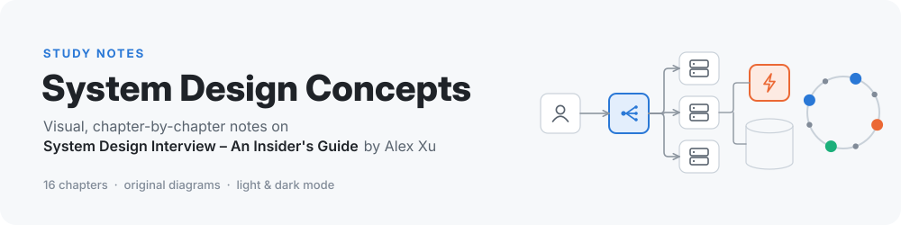
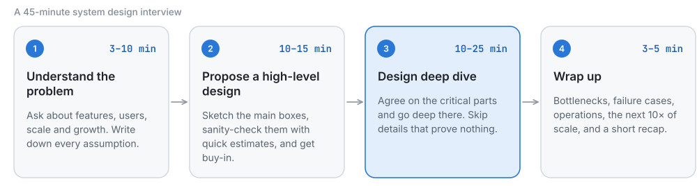

<div align="center">

<picture>
  <source media="(prefers-color-scheme: dark)" srcset="images/banner-dark.svg">
  
</picture>

<br>


</div>

> **What is this?** Study notes for every chapter of ***System Design Interview – An Insider's Guide*** (2nd edition, 2020) by **Alex Xu**. Each chapter gets its own page with a TL;DR, the requirements and back-of-the-envelope numbers, the design explained step by step, original diagrams that adapt to light and dark mode, and links for going deeper. Read the map below, pick a chapter, and you'll know what it covers in five minutes.

---

## 🗺️ The map

<picture>
  <source media="(prefers-color-scheme: dark)" srcset="images/chapter-map-dark.svg">
  
</picture>

The book has three layers. **Chapters 1–3** give you the vocabulary, the math and the interview process. **Chapters 4–7** design reusable building blocks. **Chapters 8–15** design complete products, reusing those blocks. **Chapter 16** points you to what to read next.

## 📚 Chapters

| # | Chapter | What you'll learn | Key ideas |
|:-:|---|---|---|
| 01 | [Scale From Zero To Millions Of Users][c1] | Grow one server into a system for millions, one bottleneck at a time | load balancer · DB replication · cache · CDN · stateless tier · data centers · queues · sharding |
| 02 | [Back-of-the-envelope Estimation][c2] | Estimate traffic, storage and latency from a few memorized numbers | powers of two · latency numbers · availability nines · QPS math |
| 03 | [A Framework For System Design Interviews][c3] | A repeatable 4-step process for a 45-minute interview | scope · blueprint · deep dive · wrap-up · dos and don'ts |
| 04 | [Design A Rate Limiter][c4] | Cap requests per client with shared counters and clear errors | token bucket · leaking bucket · sliding windows · Redis · HTTP 429 |
| 05 | [Design Consistent Hashing][c5] | Spread keys so adding or removing a server moves very little data | hash ring · minimal remapping · virtual nodes |
| 06 | [Design A Key-value Store][c6] | Build a Dynamo-style database from proven parts | CAP · quorums · vector clocks · gossip · hinted handoff · Merkle trees · SSTables |
| 07 | [Design A Unique ID Generator][c7] | Mint unique, time-sortable 64-bit IDs without coordination | UUID · ticket server · Snowflake layout |
| 08 | [Design A URL Shortener][c8] | Turn long links into 7-character codes and redirect fast | 301 vs 302 · base 62 · hash collisions · cache-first reads |
| 09 | [Design A Web Crawler][c9] | Crawl a billion pages a month, politely and robustly | URL frontier · politeness · priority · robots.txt · spider traps |
| 10 | [Design A Notification System][c10] | Deliver push, SMS and email reliably at millions per day | APNs/FCM · queue per channel · retries · dedupe · templates |
| 11 | [Design A News Feed System][c11] | Publish once, show the post in thousands of feeds | fanout on write vs read · celebrities · feed cache · hydration |
| 12 | [Design A Chat System][c12] | Real-time 1-on-1 and group chat with online presence | WebSocket · chat servers · KV history · message IDs · heartbeats |
| 13 | [Design A Search Autocomplete System][c13] | Return the top 5 completions within 100 ms per keystroke | trie with cached top-k · weekly rebuild · filter layer · prefix sharding |
| 14 | [Design YouTube][c14] | Upload, transcode and stream video without a ruinous CDN bill | blob storage · CDN · transcoding DAG · pre-signed URLs · long tail |
| 15 | [Design Google Drive][c15] | Store, sync and share files across devices with minimal bandwidth | block servers · delta sync · strong consistency · long polling |
| 16 | [The Learning Continues][c16] | Where to go next | papers · architecture talks · engineering blogs · practice loop |

## 🪜 The interview framework, in 30 seconds

<picture>
  <source media="(prefers-color-scheme: dark)" srcset="images/ch03-framework-dark.svg">
  
</picture>

Every design chapter (4–15) follows these four steps: **ask questions and agree on scope**, **sketch a blueprint the interviewer buys into**, **go deep on the parts that matter most**, then **wrap up with bottlenecks and next steps**. Details in [Chapter 3][c3].

## 🧩 Concept index

| Concept | Where it's explained |
|---|---|
| Load balancer, stateless web tier | [1][c1] · used in 8–15 |
| Database replication and sharding | [1][c1] · [6][c6] · [13][c13] · [15][c15] |
| Caching (and what to cache) | [1][c1] · [8][c8] · [11][c11] · [13][c13] |
| CDN | [1][c1] · [14][c14] |
| Message queues | [1][c1] · [10][c10] · [11][c11] · [14][c14] |
| Back-of-the-envelope estimation | [2][c2], then the estimates in 4, 7–15 |
| Rate limiting algorithms | [4][c4] |
| Consistent hashing, virtual nodes | [5][c5] · [6][c6] · [9][c9] |
| CAP theorem, consistency models | [6][c6] · [15][c15] |
| Quorum (N, W, R) | [6][c6] |
| Vector clocks, conflict resolution | [6][c6] · [15][c15] |
| Gossip, heartbeats, failure detection | [6][c6] · [12][c12] · [15][c15] |
| Merkle trees, hinted handoff | [6][c6] |
| Bloom filters | [6][c6] · [8][c8] · [9][c9] |
| Unique IDs (UUID, Snowflake) | [7][c7] · [8][c8] · [12][c12] |
| Base 62, HTTP 301 vs 302 | [8][c8] |
| BFS crawling, politeness, robots.txt | [9][c9] |
| Push notifications (APNs, FCM) | [10][c10] · [12][c12] |
| Fanout on write vs fanout on read | [11][c11] |
| Polling, long polling, WebSocket | [12][c12] · [15][c15] |
| Tries and top-k | [13][c13] |
| Video transcoding, DAGs, streaming protocols | [14][c14] |
| Pre-signed URLs, DRM | [14][c14] |
| Delta sync, block storage, dedupe | [15][c15] |

## 🧭 Reading plans

- **Interview soon (about a week):** [3][c3] → [2][c2] → [1][c1] → [4][c4] → [8][c8] → [11][c11] → [12][c12], then skim the TL;DRs of the rest.
- **Full read (two to three weeks):** in order. Do chapters 5–7 carefully; later chapters assume you know them.
- **Practice mode:** for any chapter from 4 to 15, read only its scope table, design it yourself for 30 minutes, then compare with the note.

## 📂 What's in this repo

```text
System_Design_Concepts/
├── README.md     ← you are here
├── chapters/     ← one note per chapter, named after the chapter
└── images/       ← original diagrams, each as -light.svg and -dark.svg
```

Diagrams switch automatically with your GitHub theme, and every one has alt text describing what it shows.

## ⚖️ About the book

These are personal study notes: summaries and explanations in my own words, with diagrams drawn from scratch. They're not a substitute for the book, and all credit for the original material goes to **Alex Xu**. If the notes help, get the full thing:

- 📘 [*System Design Interview – An Insider's Guide*, 2nd edition, on Amazon](https://www.amazon.com/dp/B08CMF2CQF)
- 🌐 [ByteByteGo](https://bytebytego.com/), Alex Xu's site, with an online version of the course and a newsletter

---

## 👤 Author

**Preet Bhalala**: [@Preetbbhalala](https://github.com/Preetbbhalala)

⭐ If these notes help you prepare, please give the repo a star!

[c1]: chapters/01-Scale-From-Zero-To-Millions-Of-Users.md
[c2]: chapters/02-Back-Of-The-Envelope-Estimation.md
[c3]: chapters/03-A-Framework-For-System-Design-Interviews.md
[c4]: chapters/04-Design-A-Rate-Limiter.md
[c5]: chapters/05-Design-Consistent-Hashing.md
[c6]: chapters/06-Design-A-Key-Value-Store.md
[c7]: chapters/07-Design-A-Unique-ID-Generator-In-Distributed-Systems.md
[c8]: chapters/08-Design-A-URL-Shortener.md
[c9]: chapters/09-Design-A-Web-Crawler.md
[c10]: chapters/10-Design-A-Notification-System.md
[c11]: chapters/11-Design-A-News-Feed-System.md
[c12]: chapters/12-Design-A-Chat-System.md
[c13]: chapters/13-Design-A-Search-Autocomplete-System.md
[c14]: chapters/14-Design-YouTube.md
[c15]: chapters/15-Design-Google-Drive.md
[c16]: chapters/16-The-Learning-Continues.md
